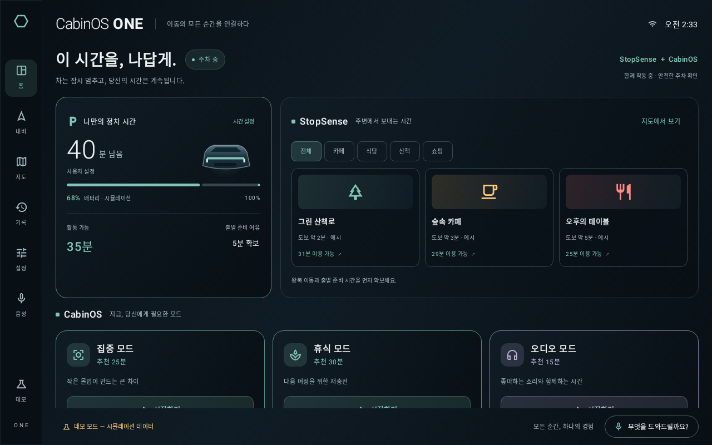
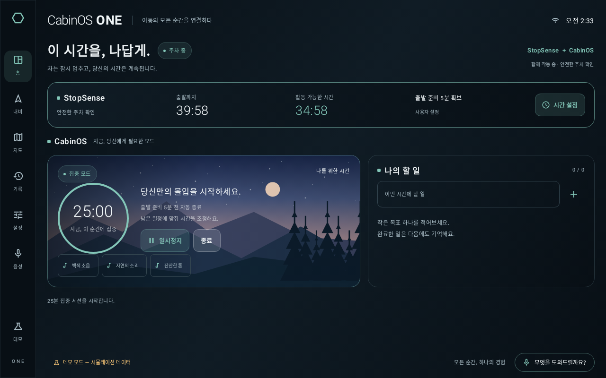
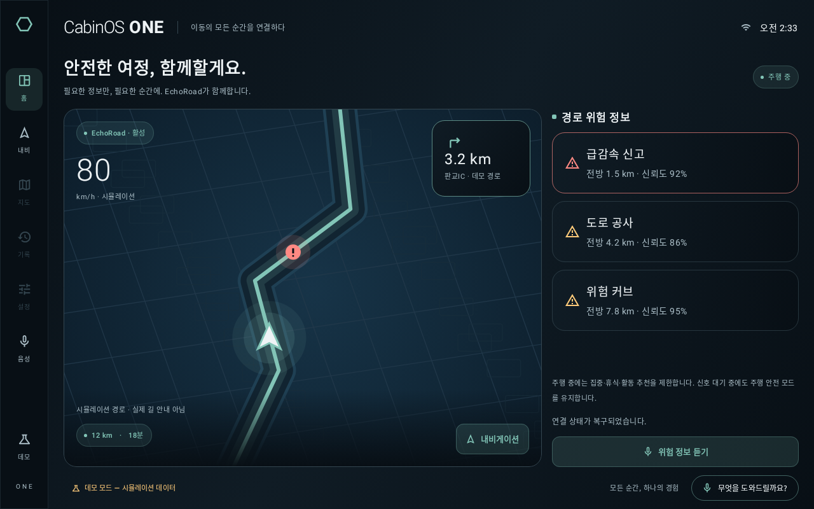

# CabinOS ONE

**차량의 상황을 이해하고, 이동의 모든 순간을 연결하다.**

**팀명: 퓨처랩스** · **버전: 0.10.0** · 차량의 주행·정차 상황에 맞춰 위험 안내, 대기 시간 활용, 집중·휴식을 연결하는 통합 차량용 앱.

**제출 APK:** [`apk/퓨처랩스_CabinOS_ONE_release.apk`](apk/퓨처랩스_CabinOS_ONE_release.apk)

**저장소:** https://github.com/hundol047/HYUNDAI

**실행 영상:** [CabinOS ONE 데모 MP4](docs/video/CabinOS_ONE_demo.mp4) · [영상 점검 후 수정 내역](docs/VIDEO_REVIEW.md)

**브라우저 체험:** [배포 안내와 접속 상태](docs/WEB_DEMO.md) — 같은 페이지에서 인터랙티브 데모·Android UI·APK 다운로드 제공.

**제출 안내:** [팀명·APK·서명·Private 저장소 확인](docs/SUBMISSION_KO.md)

위 APK는 최적화한 Release 변형을 전용 팀 릴리스 인증서로 서명한 설치 파일입니다. 차량 상태·충전·위험 정보의 시뮬레이션과 별도 내비게이션의 실제 OSM 검색/자동차 경로 요청을 아래 지원 범위에서 구분해 주세요.

현대자동차그룹 차량 앱 개발 공모전을 위한 Kotlin Android 앱입니다. EchoRoad·StopSense·CabinOS를 하나의 `UnifiedVehicleContextEngine`으로 통합했습니다. 모든 기본 UI·명령·음성 안내는 한국어입니다.

> 현재 버전은 **실행 가능한 Android 데모 앱**입니다. 차량 상태·충전·기본 홈의 주행 그림은 시뮬레이션이며, 주변 지도와 EchoRoad 내비게이션은 별도 실제 위치·OSM 검색/자동차 경로 요청 기능을 제공합니다. 서울·파리·뉴욕·도쿄·상파울루·케이프타운·시드니 실제 검색·경로 응답과 브라우저의 실제 지도 연결을 확인했습니다. 물리 GPS·실차 주행 검증은 남아 있습니다. 첫 장소 목록은 명시적인 예시 데이터입니다. 환경 재시작 후 Pleos 공식 문서와 공모전 제출 안내를 확인했습니다. Pleos SDK·실차 신호·실제 위험 데이터 연동과 실기기 검증은 아직 완료하지 않았습니다. 1차 접수의 저장소·영상 형식과 실제 차량 호환성은 구분합니다.

0.8.0에서 요청 취소·현재 GPS로 경로 재계산·GPS 상태 분리·늦은 응답/위치 차단과 큰 경로 초기 처리 속도를 보완했습니다. [문제별 수정과 성능 관찰](docs/DETAIL_REVIEW_KO.md).

0.9.0은 정차 중 GPS 갱신·실제 재연결·권한/시간 초과 안내·연속 정지 확인·복구 후 음성 안내를 보완했습니다. [GPS와 기능별 객관적 실행 결과](docs/GPS_REVIEW_KO.md). 물리 GPS/실차는 미검증이며, Overpass 주변 추천 서버는 이번에도 HTTP 502여서 정상으로 판정하지 않았습니다.

**0.10.0 음성 길찾기:** 내비의 음성 버튼 → 목적지 → 결과 번호 → 안내 시작. 길 안내 번역 31개 언어/지역 팩과 BCP 47 인식 언어 선택을 제공합니다. 지원하지 않는 번역은 영어로 대체하며 실제 STT/TTS는 기기 서비스·언어팩에 따릅니다. [사용법·언어 범위·실행 근거](docs/VOICE_NAVIGATION_KO.md).

**배포 파일:** [0.10.0 GitHub Release](https://github.com/hundol047/HYUNDAI/releases/tag/v0.10.0)에 서명 APK와 HTTPS 호스팅용 웹 ZIP을 제공합니다. 공개 웹사이트는 Pages 활성화가 필요합니다. [접속 상태](docs/WEB_DEMO.md).

## 구현된 기능

- **EchoRoad 내비게이션:** 국가 제한 없는 목적지/좌표 검색, 실제 GPS 기반 자동차 경로·한국어 회전 안내·잔여 거리/도착 예상·경로 이탈 재탐색. 정차 중 목적지 설정, 주행 조작 제한. [사용법·서비스 설정·검증 제한](docs/NAVIGATION_KO.md).
- **가게 검색:** 상호·지점·도시·주소, 내 위치 반경 20km, 실제 주소·등록 전화/영업시간·출처·상세 링크, 더 보기, GPS 없이 가게 핀 표시. 누락·도로 연결 오류를 검증하고 안내 시작을 제한합니다. [실제 확인 사례와 한계](docs/PLACE_SEARCH_KO.md) · [선택적 카카오 검색 서버](server/README.md). 모든 가게/경로를 보장하지 않으며 카카오 실서버는 키 미등록으로 미검증입니다.
- **EchoRoad 위험 안내:** 주행/신호 대기 자동 활성화, 경로 위험 점수·중복/만료/방향 필터, 알림 쿨다운, 한국어 TTS 어댑터, 주행 중 복잡한 조작 제한.
- **실내 맞춤 화면:** 차분한 5개 테마·직접 강조색·대비 보정·앱 밝기·야간 지도·저장/복원. 주차 중 변경. [사용법](docs/APPEARANCE_KO.md).
- **주변 지도:** 정차 중 실제 OSM 지도 레이어·장소 핀, 기기 위치/지도 중심 기준점, 카테고리 필터, Overpass 주변 검색, 왕복 시간 기반 계획과 외부 지도 연결. [사용법·실서버 검증 제한](docs/MAPS_KO.md).
- **StopSense + CabinOS:** 안전한 P 상태 확인 후 두 서비스를 동시에 활성화. 충전/수동 대기 시간, 복귀·출발 준비 여유 계산, 예시 주변 활동 추천, 공유 출발 계획 기반 집중·휴식·오디오 세션.
- **CabinOS:** 타이머, 할 일 추가/완료/삭제, 호흡 안내, 로컬 생성 배경 소리, 일시정지·계속·종료, 세션 이력·통계, 프리셋 저장.
- **중앙 안전 엔진:** 신호 대기에서는 정차 기능을 열지 않음. 주행·신호 손실 시 세션 일시정지. 알 수 없는 상태에서 기능 제한. 음성 명령으로 안전 규칙을 우회할 수 없음.
- **시뮬레이터:** 주행·신호 대기·주차·충전·충전 시간 변경·출발 준비·SDK 연결 손실·위치 거부·오프라인·위험 주입·전체 통합 시나리오.
- **로컬 어시스턴트:** 한국어 명령 라우팅, 기기 STT/TTS, 서비스가 없을 때 명령 버튼, 정차 중 텍스트 입력. API 키나 클라우드 AI 없이 핵심 동작.
- **Room:** 사용자 설정·활성 세션 체크포인트·할 일·세션 이력. 재실행 시 세션은 안전하게 일시정지 상태로 복원.

시스템 출발 준비 알림, 데이터 삭제, 최근 이력 보관, 화면 이탈 시 세션 중지, 선택한 차량 데이터 모드 복원도 제공합니다. 알림은 기기 절전 정책으로 늦어질 수 있습니다.

## 개발 환경 및 빌드

브라우저 빌드에는 Node.js 22와 npm도 필요합니다. Kotlin Multiplatform의 JVM/JS가 같은 상태 엔진을 컴파일합니다.

JDK 21, Android SDK Platform 35, Build Tools 35.0.0이 필요합니다. Gradle 8.11.1 Wrapper와 배포 SHA-256 검증이 포함되어 있습니다. Android Studio에서 이 디렉터리를 열고 SDK를 설치해도 됩니다.

```bash
# 일반 개발 환경
export ANDROID_HOME=/path/to/android-sdk
./gradlew :core:test :app:testDebugUnitTest :app:assembleDebug :app:assembleRelease :app:lintDebug
```

이 클라우드 환경에는 `/workspace/toolchains`에 검증된 도구를 설치했습니다.

```bash
cd /workspace/HYUNDAI
source scripts/env.sh
./scripts/build.sh
# 실행 중인 Android 기기 또는 에뮬레이터가 있을 때
./scripts/install-demo.sh
```

기존 체크아웃에서 작업하세요. 각 클라우드 작업은 이미 격리되므로 별도 Git worktree를 만들 필요가 없습니다. 현재 머신의 설치 도구·캐시는 저장소 밖에 있으며, 독립적인 새 머신은 Android Studio/SDK Manager로 같은 버전의 도구를 설치해야 합니다.

네트워크 프록시를 사용하는 머신에서는 Gradle 사용자 설정에 Java HTTP/HTTPS 프록시가 필요할 수 있습니다. 시스템에서 제공하는 인증·신뢰 저장소를 사용하고 인증서 검증을 끄지 마세요. 프록시 주소나 비밀 값은 저장소에 저장하지 않습니다.

빌드 산출물:

- `app/build/outputs/apk/debug/app-debug.apk`: 개발 인증서로 서명된 설치 가능한 데모.
- `app/build/outputs/apk/release/app-release-unsigned.apk`: 릴리스 빌드, 서명 전.
- `artifacts/`: 빌드/패키징 스크립트로 복사한 결과물. APK는 Git에 포함하지 않습니다.

제출용 APK는 `./scripts/package-submission.sh`로 생성합니다. `apk/퓨처랩스_CabinOS_ONE_release.apk`와 `apk/SHA256SUMS`를 저장소에 함께 포함합니다. 전용 서명키는 저장소 밖에 보관하며 GitHub에 올리지 않습니다. 키 백업과 재빌드 절차는 [제출 안내](docs/SUBMISSION_KO.md)를 참고하세요. 개발 인증서로 서명하는 별도 데모 유틸리티의 결과는 제출용 APK와 구분합니다.

## 실행 및 검증

- 첫 실행은 약 2초 동안 주차 상태를 확인한 후 충전 대시보드를 표시합니다. 이후에는 선택했던 소스를 복원하고 차량 상태를 새로 확인합니다.
- 왼쪽 **데모**에서 차량 상태를 선택하거나 **전체 시나리오 실행**을 누르세요.
- **주행 → 신호 대기 → 주차/충전 → 집중/휴식 → 출발 준비 → 주행**에 따라 화면이 자동 전환됩니다.
- 마이크 권한은 정차 중 요청합니다. 주행 중에는 새 권한 창을 열지 않으며, 이미 허용한 마이크로 짧은 명령을 사용할 수 있습니다. 한국어 TTS 언어팩과 음성 인식 서비스가 없는 에뮬레이터에서는 화면/명령 버튼으로 사용하세요. 음성 서비스 동작은 기기 구성에 따라 달라집니다.
- **실차 연결**은 미지원 상태를 보여주며 주차 기능을 잠급니다. 실차 연결 성공을 모사하지 않습니다.

```bash
./gradlew :core:test                 # 도메인 안전·시간·위험·통합 테스트
./gradlew :app:testDebugUnitTest     # Compose 전환 + 실제 Room 저장/복원 (Robolectric)
./gradlew :app:lintDebug             # Android 정적 검사
python3 scripts/device_smoke.py      # 실행 중인 Android 장치의 실제 UI 검증
```

실제 실행 결과와 제한은 [검증 보고서](docs/VALIDATION.md)를 확인하세요. 로컬 통과와 원격 GitHub Actions 결과는 구분해 기록합니다. 공개 페이지 배포 준비·상태는 [웹 데모 안내](docs/WEB_DEMO.md)를 참고하세요.

## 구조 및 제출 자료

| 경로 | 내용 |
|---|---|
| `core/` | JVM/JS 공유 Kotlin 상태 엔진·안전 규칙·위험 점수·추천·공유 타이머·단위/통합 테스트 |
| `app/` | Compose UI·MVVM·Hilt·Room·Android 음성/위치/오디오 어댑터 |
| [ARCHITECTURE.md](docs/ARCHITECTURE.md) | 구조·상태 전환·동시성·복원 설계 |
| [SDK_CAPABILITIES.md](docs/SDK_CAPABILITIES.md) | SDK 확인 상태·권한·실제/데모 구분 |
| [DEMO_KO.md](docs/DEMO_KO.md) | 한국어 공모전 시연 순서 |
| [LIMITATIONS.md](docs/LIMITATIONS.md) | 미구현·실차 검증·배포 제한 |
| [VALIDATION.md](docs/VALIDATION.md) | 이번 작업에서 실행한 검사 결과 |

## 실제 UI 렌더링

아래 이미지는 앱의 Compose UI를 Robolectric 네이티브 그래픽 모드(API 29, 1280×800)에서 렌더링한 결과입니다. 실차/에뮬레이터 캡처로 표기하지 않습니다.





## 웹 데모와 영상 재현

```bash
./scripts/build-web.sh
# 내부 점검용 서버; 공개 링크는 GitHub Pages 배포를 사용합니다.
python3 scripts/serve-web.py --directory build/site
# 브라우저 검사·촬영 도구 (Chromium과 FFmpeg 필요)
npm ci --prefix scripts/web
# 시스템 Chromium이 없으면 cd scripts/web && npx playwright install chromium
node scripts/web/verify.cjs
node scripts/web/verify-map.cjs
node scripts/web/record-demo.cjs
```

영상은 실제 브라우저 조작을 녹화했습니다. 웹·Android가 같은 Kotlin 엔진을 사용하지만 실차 연동과 APK 실기기 실행 검증은 남아 있습니다.

실제 OSM 타일·Nominatim·OSRM 요청과 브라우저 지도/검색/경로 처리를 확인했습니다. 별도 주변 장소 제공자 Overpass는 이번 실서버 검사에서 502/시간 초과가 발생해 장소 실데이터 검증이 남아 있습니다. [지도 검증 범위](docs/MAPS_KO.md)를 확인하세요.

공식 공모전: https://appdevchallenge.auto-hmg.io/guide/submission

지도 범위·조작·성능: [6개 대륙 실경로·확대/축소·GPS 갱신 점검](docs/MAP_PERFORMANCE_KO.md). 147개 JVM/Android 테스트와 108개 브라우저 검사를 기준으로 하며 실기기 FPS·실도로 정확도는 별도 검증 대상입니다.
