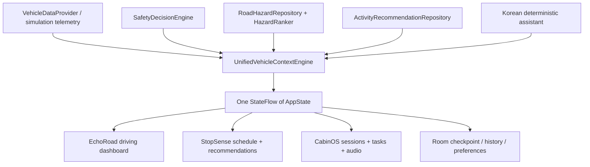

# CabinOS ONE architecture

`core` is a Kotlin Multiplatform domain module targeting JVM and JavaScript. `app` is a native Android application using Compose, Navigation Compose, lifecycle-aware StateFlow collection, Hilt, Coroutines and Room. Android framework integrations live behind provider interfaces. The browser demo compiles this same core to JavaScript; its UI calls a thin bridge, so safety and timers are shared rather than separately simulated. No cloud AI or backend is required to run the demo.

## Safety and lifecycle

- Safety precedence: missing/disconnected/stale/invalid telemetry → UNKNOWN; any positive speed → DRIVING; zero speed in D/R → STOPPED_IN_TRAFFIC; reliable P with zero speed must be stable for 1.5 seconds before unlocking parked features. Lost telemetry, source changes and large clock gaps require fresh confirmation. A manual voice command cannot establish physical parking.
- CHARGING, RESTING and PREPARING_DEPARTURE are contextual refinements of a confirmed physical parked state. They never override motion or a loss of trust.
- A provider sends timestamped samples. Samples older than 5 seconds, future timestamps, negative speeds and NaN are rejected conservatively. The current app heartbeat is explicitly simulation telemetry; actual telemetry is **not** synthesized in real mode.
- Every mutation runs on Android Main, or the single browser event loop. Coroutine collectors observe the same authoritative StateFlow. There are no independent StopSense/CabinOS departure timers.
- Parking debounce is a timestamped candidate, not a UI toggle. Sensor recovery must pass it again. There is no automatic session resumption after drive interruption.
- Running sessions use an absolute deadline bounded by `departure - preparation buffer - return time`. A shorter charge estimate truncates the deadline; a longer one does not silently extend the chosen session. Activity recommendations account for the complete round trip. Selecting a place reserves the return trip for an already-outside user. Starting an in-car session removes that return reservation.
- Manual departure overrides are marked user supplied; future charging updates use the earlier of the manual and charging deadlines. A repeated unchanged charging estimate does not slide departure forward.
- On process recreation Room restores settings, deadlines and progress, **never** the physical parked state. A running session restores paused. Timers use elapsed wall-clock deadlines; a clock jump fails closed until parking is re-established. Foreground/background transitions explicitly invalidate parking and pause sessions. OS reminders are inexact reminders of a saved plan, not background vehicle monitoring or exact alarms.

## EchoRoad

Hazards contain no vehicle identifier, use pseudonymous event IDs and expire. Relevance considers route ID, along-route distance, heading, confidence, age, severity and independent-report count. Duplicate IDs, expired events, past-route events and low-confidence events are removed. Alerts have a global cooldown and per-event suppression. Location denial removes route alerts. Route geometry and points of interest in the demo are illustrative, not actual navigation or verified businesses. Consent is stored locally; no sharing backend or external data transmission is implemented.

## Persistence

Room stores typed preferences, sessions, a checkpoint and user tasks. Logical state writes are transactional. A restore pauses an interrupted active session. The database retains at most 100 archived sessions plus the active session. A parked-only confirmation deletes personal settings, tasks, sessions and the departure plan in one transaction. State writes and task mutations share a mutex to prevent stale writes from reviving deleted records. Storage failures are surfaced in Settings. The selected simulation/real source is persisted separately and never establishes physical parking. Android backups are disabled. There are no embedded API keys. Task labels have a local length limit. Actual SQLite/runtime persistence is covered by the device smoke script when a device is available.

## Android adapters

Android framework TTS/STT, LocationManager and an external `geo:` intent use public platform APIs. Recognition explicitly requests Korean and prefers offline operation, but availability and offline support are controlled by the installed recognition service. With no recognizer, preset commands and typed parked-only commands remain available. TTS requires a Korean voice pack. Local ambient audio is generated PCM, not a streaming service. Motion, pausing, backgrounding and any audio-focus loss stop audio. Navigation refuses simulation data, missing permission and locations older than 60 seconds. Microphone permission prompts are limited to verified parking; an already granted recognizer remains available for short commands while driving.

Vehicle, charging and Pleos-specific navigation integrations remain unavailable pending official SDK documentation/artifacts. Real mode therefore reports no usable telemetry, presents UNKNOWN, and does not unlock parked functionality. See SDK_CAPABILITIES.md. Retrofit/OkHttp are deliberately not included: there is no verified external API contract to call.

## Browser and distribution

`core/src/commonMain` contains the domain engine. JVM/JS actuals supply the clock and unique IDs. `core/src/jsMain/kotlin/.../BrowserBridge.kt` exports a small `window.CabinOS` interface. The HTML/CSS/JS frontend manages presentation, transient tasks and local sound; the Kotlin engine authorizes every mode, activity and preference change. Real-source mode is disconnected/UNKNOWN and does not show a fabricated route.

`./scripts/build-web.sh` stages a static site at `build/site` containing the shared engine, Android UI gallery, the exact committed release APK and final recording. `.github/workflows/pages.yml` deploys that artifact to GitHub Pages after repository Pages is enabled. Hosting survives this workspace stopping; it has no intentional 24-hour expiry.

## Android reminders

An explicit unexported receiver handles an immutable PendingIntent carrying a one-use token. The alarm tracks the shared departure deadline minus the preparation buffer. Changed plans invalidate old tokens; driving cancels alarms; early, replayed or stale deliveries do not notify. Android 13+ notification permission and system notification settings are checked at delivery. The text refers only to a saved plan. Alarms can be delayed, and reboot/force-stop requires reopening the app.
