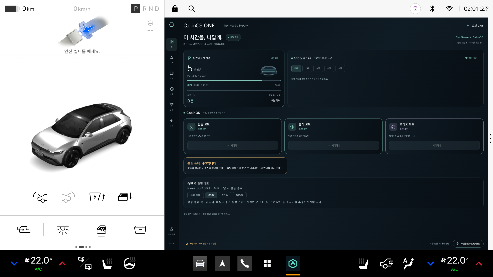

# Pleos 공식 설치 구성과 원격 검증

## 최신 결과 — 실제 차량 시나리오 13/13 통과

2026-11-07 [공식 이미지 실행 42361658349](https://github.com/hundol047/HYUNDAI/actions/runs/42361658349), 앱 소스 `9820982`, 검증용 릴리스 APK에서 통과했습니다. [회귀 검사 CI 42361784127](https://github.com/hundol047/HYUNDAI/actions/runs/42361784127)는 테스트 보완 커밋 `58781f9`에서 성공했습니다. 이후 증거·문서 추가는 앱 코드를 변경하지 않습니다.

| 항목 | 실제 관측 |
|---|---|
| 공식 구성 | Pleos 2.1.0 / API 34, 배포 체크섬 일치, RAM 4096MB, Cold boot, KVM |
| 설치 파일 | 빌드 APK와 설치 후 pull한 APK의 SHA-256 일치 |
| 차량 상태 | P/0 확인 후 해제, D/0·35km/h·UNKNOWN 잠금, P/0 복귀 후 1.5초 재확인 |
| SDK 입력 | SOC 68→75→80, 충전 ON/OFF, Console DDS ready |
| 활동 마감 | 45분 계획·80% 목표·집중 시작. 실제 로그 RUNNING → 안전 PAUSED → SOC 목표에 따른 COMPLETED, 활동 예산 0 |
| 회귀 검사 | 공통 134개, Android 102개, 검증 도구 13개 통과. release 빌드·lint 오류 0 |
| 증거 | SDK 이벤트 446개, 2560×1440 ADB 연속 원본 녹화 173.85초, 전체 디코딩 오류 0 |

**[검증 APK](../apk/CabinOS_ONE_Pleos_validation.apk) · [원본 영상](validation/pleos-vehicle-20261107/device-screen.mp4) · [결과 JSON](validation/pleos-vehicle-20261107/result.json) · [원본 이벤트](validation/pleos-vehicle-20261107/raw-evidence.json)**

APK SHA-256: `87120099be979e98ebfe91bc7ce5ce2afdbf3f74e06a644d850f521c24730a33`. 서명자는 `CN=CabinOS CI validation`이며 정식 배포 키와 다릅니다. 기존 배포 서명 APK를 대체하지 않으며 **별도 새 AVD**에 설치하세요. 저장소의 수정 브랜치를 사용합니다.

```bash
git clone --branch fix/pleos-guide-alignment https://github.com/hundol047/HYUNDAI.git
cd HYUNDAI
sha256sum -c apk/VALIDATION_SHA256SUMS
# 아래 공식 설치 절차로 만든 새 Pleos AVD가 emulator-5554인 경우:
adb -s emulator-5554 install apk/CabinOS_ONE_Pleos_validation.apk
adb -s emulator-5554 forward tcp:8088 tcp:8088
adb -s emulator-5554 shell am start -n io.cabinos.one/.MainActivity
# 브라우저에서 http://localhost:8088을 열어 두고 차량 상태를 변경합니다.
```

이는 **차량 데이터·안전 잠금·활동 마감 검증 통과**입니다. 소프트웨어 그래픽에서 UI 지연과 안전 일시정지가 실제로 발생했고, 부드러운 집중 화면 표시나 공식 외장 GPU 성능을 인증한 결과는 아닙니다. 초기 vendor 서비스 panic과 Pleos 입력기(`ai.umos.inputmethod`) 오류도 원문에 남아 있습니다. 최종 수집 시 DDS emulator·profile·vehicle_ext·diagnostic_report·vehicle_diagnostic 프로세스는 실행 중이었고 실제 SDK 변경이 완료됐습니다. 이미지 내부 오류를 모두 제거했다고 주장하지 않습니다.

실제 목적지 ETA, 마이크 음성 인식, 정식 분할 창 호환성·제출 완료는 별도이며 `submissionReady=false`를 유지합니다. 원본 `raw-evidence.json`의 자동 생성 `visualReview=pending`도 보존했습니다. 별도 결과 JSON에는 직접 확인한 잠금·목표 도달·복귀 화면의 검토 범위를 기록했습니다.



## 실행 방법

기준은 [Emulator 설치 및 실행](https://document.pleos.ai/docs/connect/guide/getting-started/application-development/setup-connect-sdk-emulator)과 [Emulator 설정](https://document.pleos.ai/docs/connect/guide/getting-started/application-development/configure-pleos-connect-emulator)입니다.

- Android API 28 이상, Gradle 8 이상, Java/Kotlin: 현재 프로젝트는 minSdk 29, Gradle 8.11.1, Kotlin을 사용합니다.
- 공식 Pleos Connect 2.1.0 / API 34 이미지를 설치하고 RAM 4GB, Cold boot를 사용합니다.
- 공식 `devices.xml`의 표시 이름은 `Pleos Connect v2.1.0`, 내부 ID는 `Pleos_Connect_v2_0`입니다. 내부 ID만 보고 구버전이라고 판정하면 안 됩니다.
- 배포 이미지의 `source.properties`는 RAM 8192MB를 지정하지만 공식 기기 프로필과 설치 가이드는 4GB입니다. 설치 스크립트의 기본값은 가이드에 맞춘 4096MB입니다.

### 로컬 PC의 공식 경로

Android Studio SDK Manager에 운영체제에 맞는 공식 인덱스를 추가하고 API 34의 Pleos 이미지를 설치한 뒤 Studio를 재시작합니다. Device Manager에서 Automotive → Pleos Connect v2.1.0 → Cold boot → RAM 4GB → API 34를 선택합니다. 인덱스 주소와 APK 설치 명령은 [실행 가이드](PLEOS_VEHICLE_STATE_KO.md)를 따릅니다.

공식 설정 문서는 외장 GPU 최소 사양을 별도로 명시합니다. GPU를 갖춘 PC에서 하드웨어 그래픽을 사용해야 이 조건까지 검증할 수 있습니다. 일반 Android 이미지 또는 웹 데모는 Pleos 실행 검증을 대신하지 않습니다.

### KVM이 없는 클라우드에서의 대안: GitHub Actions KVM runner

이 저장소의 `Android verification` 워크플로에서 수동 실행하면 Ubuntu runner의 KVM을 사용합니다. 다음 명령은 수정 브랜치의 공식 이미지 설치·APK 실행 진단을 실행합니다.

```bash
gh workflow run android.yml \
  --ref fix/pleos-guide-alignment \
  -f record_pleos_preview=false
gh run list --workflow android.yml --branch fix/pleos-guide-alignment \
  --event workflow_dispatch --limit 1
# 위 목록의 실행 ID를 사용합니다.
gh run watch RUN_ID --exit-status
gh run download RUN_ID --name Pleos-actual-device-diagnostics \
  --dir artifacts/pleos-setup-RUN_ID
```

워크플로는 공식 배포 SHA-1 `b4f858d5bcc6c71506d7edfc872bcb9e5a11acaa`를 검증하고, 4GB AVD를 만든 뒤 `-no-snapshot`으로 실행합니다. ADB 서버를 먼저 시작하여 호스트 인증키를 준비하고 `adb forward tcp:8088 tcp:8088`으로 공식 Console에 접속합니다. 현재 소스로 공식 SDK를 포함한 릴리스 APK를 빌드하고 검증용 임시 키로 서명한 뒤, 설치된 APK를 다시 pull해 빌드 산출물과 SHA-256을 비교합니다. 초기 진단 기록의 배포 서명 0.11.0 APK와 후속 수정본의 검증용 APK는 구분합니다. 검증용 키는 정식 배포 키가 아니므로 별도 새 AVD에서 설치합니다. 화면 자동화에서는 AVD의 UI 애니메이션만 끄고, 정차 1.5초와 신호 만료 타이머는 변경하지 않습니다.

이 경로의 그래픽은 `swiftshader_indirect` 소프트웨어 렌더링입니다. CPU 가속은 KVM으로 확보하지만 공식 외장 GPU 조건을 충족한 테스트는 아닙니다. CI 성공도 전체 시나리오 통과를 의미하지 않습니다.

## Console 자동화에서 필요한 브라우저 세션

Pleos 2.1.0 Console이 제공하는 HTML의 `sendBrowserHeartbeat()`는 다음 요청을 1초마다 보냅니다.

```text
POST /browser/session?client=<고유한 클라이언트 ID>
POST /browser/session?client=<같은 ID>&closing=1  # 종료할 때
```

페이지 HTML을 GET하거나 차량 API만 PUT하는 것은 브라우저를 열어 둔 것과 다릅니다. 자동화는 `scripts/pleos_console_session.py`로 이 공개 화면의 세션 유지 동작을 재현합니다. 수동 사용 시에는 Console 탭을 열어 둡니다. 화면 하단의 AVD 선택은 `/vehicle/hvac/mode`를 호출하는 HVAC 모드 설정이며, 브라우저 접속 신호를 대신하지 않습니다.

이 경로는 원본 이미지와 SDK를 그대로 사용합니다. root, 서비스 강제 재시작, SELinux 변경 또는 앱 시뮬레이션을 사용하지 않습니다. 자동 검증은 HTTP 성공뿐 아니라 실제 앱의 SDK 이벤트와 연속 화면 녹화를 함께 검사합니다.

## 판정 기준

1. 공식 이미지 다운로드 체크섬과 실행 fingerprint가 모두 맞아야 합니다.
2. `sys.boot_completed=1`, APK 설치·실행과 설치 APK 해시가 확인돼야 합니다.
3. Console 웹 페이지 접속과 차량 상태 변경 성공은 별도입니다. `consoleScenarioReady=false` 또는 HTTP 503이면 상태 변경은 실패입니다.
4. SDK SOC 읽기 성공만으로 기어 전환·충전 목표 자동 종료·내비 ETA까지 통과 처리하지 않습니다.
5. `submissionReady=false`는 제출 완료 판정이 아니라는 의미입니다. 설치·실행 진단 뒤 별도 연속 녹화 시나리오를 수행하며, 그 검사는 모두 통과해야 합니다.

## 초기 진단 기록 (접속 유지 수정 전)

2026-11-07 [실행 42351141190](https://github.com/hundol047/HYUNDAI/actions/runs/42351141190), 소스 `c5e78de`, 기존 서명 0.11.0 APK를 검사했습니다. CI의 진단 수집 job은 성공했습니다.

| 검사 | 관측 결과 | 판정 |
|---|---|---|
| 공식 이미지 | 배포 체크섬 일치, Pleos 2.1.0 fingerprint 확인 | 통과 |
| RAM / 부팅 | 4096MB / Cold boot / KVM, Android 부팅 약 31초 | 통과 |
| APK 설치·실행 | 설치 APK SHA-256이 저장소 APK와 일치, 실제 화면 확인 | 통과 |
| SDK 읽기 | SOC 100%, 충전 false, PARK / 속도 0 수신 | 기본 읽기 통과 |
| Console 접속 | HTML·catalog·state 응답 수집 | 접속 통과 |
| Console 상태 변경 | HTTP 503 / `emulator_inactive`, `dds_ready.all=false` | 실패 |
| 지속 정차 신호 | 약 17초 표본에서 UNKNOWN→PARKED→UNKNOWN→PARKED | 안정성 미확인 |
| 전체 앱 시나리오 | 기어·SOC 변경 입력 실패로 수행 불가 | 미완료 |


[기계 판독 요약](validation/pleos-setup-20261107.json) · [원본 진단 산출물](https://github.com/hundol047/HYUNDAI/actions/runs/42351141190/artifacts/13564979664)

서명 APK SHA-256: `7279b860a012c08d5f929573b3c1bdfd245d1ac8b8f6af74e5e6b4d4451d0543`.

Console의 공개 UI가 사용하는 AVD Enabled 요청도 503이었습니다. 이미지 안의 profile·vehicle_ext·diagnostic 등 서비스가 부팅 초기에 종료된 로그가 있습니다. 이를 GPU 부재나 앱 코드의 단일 문제로 확정하지 않습니다. 추가 부팅 로그 수집 실행의 결과를 함께 확인합니다.


### 재실행과 초기 오류 확인

[실행 42351829707](https://github.com/hundol047/HYUNDAI/actions/runs/42351829707)은 설정·가속·부팅 초기 로그를 추가로 수집했습니다. 두 번째 실행도 APK 설치·SDK 기본 읽기는 성공했고 Console 상태 변경은 실패했습니다.

- `avd-config.ini`: `hw.ramSize=4096`, `fastboot.forceColdBoot=yes`.
- `acceleration.txt`: `KVM (version 12) is installed and usable.`
- `full-boot-logcat.txt`: 차량용 `eth0` 준비 지연, DDS participant 생성 실패, 여러 vendor 서비스의 `Option::unwrap()` panic을 확인했습니다. 오류 위치는 이미지 내부 `app-framework/src/app.rs:220`입니다.
- 이 오류는 CabinOS APK 설치 전부터 발생했습니다. 앱의 Gradle 설정 누락만으로 설명할 수 없으며, 아직 DDS 실패의 근본 원인이나 503과의 단일 인과관계는 확정하지 않았습니다.

[추가 진단 산출물](https://github.com/hundol047/HYUNDAI/actions/runs/42351829707/artifacts/13565534736)에 원문 로그가 있습니다. 네트워크 준비 후 기존 Console 서비스를 재시작하는 [격리 진단 실행 42352454763](https://github.com/hundol047/HYUNDAI/actions/runs/42352454763)도 수행했습니다. Android Emulator의 loopback 디버그 콘솔은 연결됐지만 명령 응답이 20초 내 완료되지 않아, 서비스 재시작 단계에 도달하지 못했습니다. 이 시도를 성공한 우회 방법으로 권장하지 않습니다. 이미지·SELinux·앱 권한을 변경하지 않았으며 해당 실험은 별도 브랜치에만 있습니다.

### 후속 조사: Console 활성화와 속도 수신 순서

[실행 42353422365](https://github.com/hundol047/HYUNDAI/actions/runs/42353422365)에서 공식 페이지와 같은 브라우저 접속 신호를 추가하자 원본 이미지에서 `emulator_active=true`, `controls.dds_ready.all=true`, 차량 변경 HTTP 200이 확인됐습니다. 실제 서명 APK의 SDK도 SOC 68%와 충전 스위치 ON을 수신했습니다. 따라서 초기 부팅 DDS 오류만으로 Console 503의 원인을 확정하면 안 됩니다. 이 실행은 root나 서비스 재시작을 사용하지 않았습니다.

이후 [현재 소스 진단 실행 42353934081](https://github.com/hundol047/HYUNDAI/actions/runs/42353934081)의 로그에서 다른 앱 문제가 확인됐습니다. 속도 폴링이 `timestampNs=56609418943`을 먼저 전달한 뒤 대기 중이던 콜백 `56239128972`가 도착했습니다. 안전 판정기는 이를 역순 수신으로 보고 UNKNOWN으로 잠갔습니다. 수정은 CONTINUOUS 속도를 구독 콜백에서만 받고, ON_CHANGE 기어는 주기적으로 다시 읽도록 합니다. 오래된 속도 만료, 주행 중 잠금, 1.5초 정차 확인 조건은 그대로 적용됩니다.

공식 외장 GPU 조건에서의 그래픽 검증은 별도로 남습니다. 소프트웨어 그래픽 실행 성공을 공식 GPU 검증 완료로 표시하지 않습니다.

### 화면 렌더링과 차량 검증 분리

속도 수신 순서를 수정한 뒤에도 소프트웨어 그래픽 환경에서 시간 설정 창을 열면 UI 스레드가 지연됐습니다. 차량 worker는 새 신호를 계속 수신했지만 UI 스레드의 판정 작업이 밀려 만료·잠금이 발생하고 창이 닫혔습니다. `VehicleStateProvider`의 신호 검증과 250ms 만료 감시를 순차 실행하는 백그라운드 scope로 옮겼습니다. 시작·종료와 이전 연결의 늦은 콜백은 동기화와 epoch 검사로 보호합니다.

실제 정차 확인 시간은 엔진의 `parkingConfirmedForMs`로 기록합니다. 로그에서 처음 보인 정차 이벤트 시각을 시작 시각으로 추정하면 수 ms 오차로 정상 1.5초 판정도 실패로 보일 수 있기 때문입니다. 1499ms 잠금·1500ms 해제 경계 테스트와 UI 처리 없이 신호 수신·3001ms 만료가 진행되는 테스트를 추가했습니다. 실제 만료 기준과 정차 지연은 줄이지 않았습니다.

### 실제 터치 입력과 세션 완료 판정

[실행 42358200839](https://github.com/hundol047/HYUNDAI/actions/runs/42358200839)에서는 차량 상태 검사 11개가 통과했고, 초기 연결 이후 신호 게이트의 불필요한 만료가 사라졌습니다. UIAutomator의 좌표 클릭으로 시간 설정 창이 열리지 않아, 계층 조회는 UIAutomator를 사용하고 실제 터치는 `adb shell input -d 0 tap`으로 분리했습니다. AAOS의 운전자 사용자와 창 배치를 고려한 검증 도구 변경이며 앱의 안전 잠금을 우회하지 않습니다.

[실행 42359119559](https://github.com/hundol047/HYUNDAI/actions/runs/42359119559)에서 시간 설정과 SOC 목표 설정, 실제 SDK SOC 68→75→80, 충전 ON/OFF, 목표 도달 시 활동 예산 0이 확인돼 당시 12개 검사가 통과했습니다. 그러나 화면·원본 로그를 검토하니 `sessionStatus`는 모두 null이었습니다. 어시스턴트 창의 배치가 달라지는 동안 좌표 터치가 다른 명령에 전달돼 집중 세션은 시작되지 않았습니다. 이 실행을 집중 자동 종료 증거로 사용하지 않습니다.

후속 검증은 집중 카드의 첫 번째 `시작하기` 버튼을 직접 누르고, 실제 SDK 이벤트에서 `RUNNING`을 확인한 다음 SOC를 변경합니다. 새 검사 `sessionCompletedAtSocTarget`은 실제 실행 기록 뒤 SOC 목표로 예산이 0이 되고 `COMPLETED`가 기록돼야 통과합니다. 세션 없이 예산만 0이 된 경우, 시작 이전에 완료 기록만 있는 경우는 실패합니다. 화면 버튼 조작은 마이크 음성 인식 검증과 구분합니다.

### 일시정지 중인 세션의 출발 마감 적용

[실행 42360820665](https://github.com/hundol047/HYUNDAI/actions/runs/42360820665)에서는 실제 집중 세션 `RUNNING`을 확인했습니다. 소프트웨어 그래픽 환경의 화면 처리 지연으로 새 표본이 엔진에 전달되기까지 간격이 벌어져 세션이 안전하게 `PAUSED`로 바뀌었고, 그 뒤 SOC 80%로 활동 예산이 0이 돼도 세션은 끝나지 않았습니다. 새 13번째 검사가 이 문제를 실패로 검출했습니다.

일시정지는 활동 타이머를 멈추지만 공유 출발 마감까지 연장해서는 안 됩니다. 엔진은 이제 일시정지 중에도 계획된 활동 마감이 지나면 잔여 시간을 0으로 만들고 `COMPLETED`를 기록합니다. 세션을 자동 재개하거나 주행 잠금을 해제하지 않습니다. 실제 SDK SOC만 목표 완료를 유발하는지, D 상태가 계속 잠기는지, 완료 이력이 한 번만 기록되는지, 수동 일시정지가 마감을 연장하지 않는지 테스트했습니다. 원격 그래픽 환경의 처리 지연은 외장 GPU 성능 검증과 별도로 봅니다.
