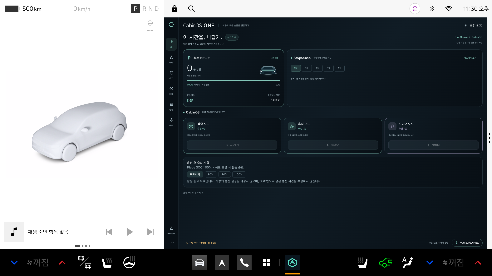

# Pleos 공식 설치 구성과 원격 검증

## 실행 방법

기준은 [Emulator 설치 및 실행](https://document.pleos.ai/docs/connect/guide/getting-started/application-development/setup-connect-sdk-emulator)과 [Emulator 설정](https://document.pleos.ai/docs/connect/guide/getting-started/application-development/configure-pleos-connect-emulator)입니다.

- Android API 28 이상, Gradle 8 이상, Java/Kotlin: 현재 프로젝트는 minSdk 29, Gradle 8.11.1, Kotlin을 사용합니다.
- 공식 Pleos Connect 2.1.0 / API 34 이미지를 설치하고 RAM 4GB, Cold boot를 사용합니다.
- 공식 `devices.xml`의 표시 이름은 `Pleos Connect v2.1.0`, 내부 ID는 `Pleos_Connect_v2_0`입니다. 내부 ID만 보고 구버전이라고 판정하면 안 됩니다.
- 배포 이미지의 `source.properties`는 RAM 8192MB를 지정하지만 공식 기기 프로필과 설치 가이드는 4GB입니다. 설치 스크립트의 기본값은 가이드에 맞춘 4096MB입니다.

### 로컬 PC의 공식 경로

Android Studio SDK Manager에 운영체제에 맞는 공식 인덱스를 추가하고 API 34의 Pleos 이미지를 설치한 뒤 Studio를 재시작합니다. Device Manager에서 Automotive → Pleos Connect v2.1.0 → Cold boot → RAM 4GB → API 34를 선택합니다. 인덱스 주소와 APK 설치 명령은 [실행 가이드](PLEOS_VEHICLE_STATE_KO.md)를 따릅니다.

공식 설정 문서는 외장 GPU 최소 사양을 별도로 명시합니다. GPU를 갖춘 PC에서 하드웨어 그래픽을 사용해야 이 조건까지 검증할 수 있습니다. 일반 Android 이미지 또는 웹 데모는 Pleos 실행 검증을 대신하지 않습니다.

### KVM이 없는 클라우드에서의 대안: GitHub Actions KVM runner

이 저장소의 `Android verification` 워크플로에서 수동 실행하면 Ubuntu runner의 KVM을 사용합니다. 다음 명령은 수정 브랜치의 공식 이미지 설치·APK 실행 진단을 실행합니다.

```bash
gh workflow run android.yml \
  --ref fix/pleos-guide-alignment \
  -f record_pleos_preview=false
gh run list --workflow android.yml --branch fix/pleos-guide-alignment \
  --event workflow_dispatch --limit 1
# 위 목록의 실행 ID를 사용합니다.
gh run watch RUN_ID --exit-status
gh run download RUN_ID --name Pleos-actual-device-diagnostics \
  --dir artifacts/pleos-setup-RUN_ID
```

워크플로는 공식 배포 SHA-1 `b4f858d5bcc6c71506d7edfc872bcb9e5a11acaa`를 검증하고, 4GB AVD를 만든 뒤 `-no-snapshot`으로 실행합니다. ADB 서버를 먼저 시작하여 호스트 인증키를 준비하고 `adb forward tcp:8088 tcp:8088`으로 공식 Console에 접속합니다. 설치된 APK를 다시 pull해 저장소 APK와 SHA-256을 비교합니다.

이 경로의 그래픽은 `swiftshader_indirect` 소프트웨어 렌더링입니다. CPU 가속은 KVM으로 확보하지만 공식 외장 GPU 조건을 충족한 테스트는 아닙니다. CI 성공도 전체 시나리오 통과를 의미하지 않습니다.

## 판정 기준

1. 공식 이미지 다운로드 체크섬과 실행 fingerprint가 모두 맞아야 합니다.
2. `sys.boot_completed=1`, APK 설치·실행과 설치 APK 해시가 확인돼야 합니다.
3. Console 웹 페이지 접속과 차량 상태 변경 성공은 별도입니다. `consoleScenarioReady=false` 또는 HTTP 503이면 상태 변경은 실패입니다.
4. SDK SOC 읽기 성공만으로 기어 전환·충전 목표 자동 종료·내비 ETA까지 통과 처리하지 않습니다.
5. `submissionReady=false`는 제출 완료 판정이 아니라는 의미입니다. 이 진단은 설치·실행 확인용입니다.

## 이번 실행 결과

2026-11-07 [실행 42351141190](https://github.com/hundol047/HYUNDAI/actions/runs/42351141190), 소스 `c5e78de`, 기존 서명 0.11.0 APK를 검사했습니다. CI의 진단 수집 job은 성공했습니다.

| 검사 | 관측 결과 | 판정 |
|---|---|---|
| 공식 이미지 | 배포 체크섬 일치, Pleos 2.1.0 fingerprint 확인 | 통과 |
| RAM / 부팅 | 4096MB / Cold boot / KVM, Android 부팅 약 31초 | 통과 |
| APK 설치·실행 | 설치 APK SHA-256이 저장소 APK와 일치, 실제 화면 확인 | 통과 |
| SDK 읽기 | SOC 100%, 충전 false, PARK / 속도 0 수신 | 기본 읽기 통과 |
| Console 접속 | HTML·catalog·state 응답 수집 | 접속 통과 |
| Console 상태 변경 | HTTP 503 / `emulator_inactive`, `dds_ready.all=false` | 실패 |
| 지속 정차 신호 | 약 17초 표본에서 UNKNOWN→PARKED→UNKNOWN→PARKED | 안정성 미확인 |
| 전체 앱 시나리오 | 기어·SOC 변경 입력 실패로 수행 불가 | 미완료 |



[기계 판독 요약](validation/pleos-setup-20261107.json) · [원본 진단 산출물](https://github.com/hundol047/HYUNDAI/actions/runs/42351141190/artifacts/13564979664)

서명 APK SHA-256: `7279b860a012c08d5f929573b3c1bdfd245d1ac8b8f6af74e5e6b4d4451d0543`.

Console의 공개 UI가 사용하는 AVD Enabled 요청도 503이었습니다. 이미지 안의 profile·vehicle_ext·diagnostic 등 서비스가 부팅 초기에 종료된 로그가 있습니다. 이를 GPU 부재나 앱 코드의 단일 문제로 확정하지 않습니다. 추가 부팅 로그 수집 실행의 결과를 함께 확인합니다.


### 재실행과 초기 오류 확인

[실행 42351829707](https://github.com/hundol047/HYUNDAI/actions/runs/42351829707)은 설정·가속·부팅 초기 로그를 추가로 수집했습니다. 두 번째 실행도 APK 설치·SDK 기본 읽기는 성공했고 Console 상태 변경은 실패했습니다.

- `avd-config.ini`: `hw.ramSize=4096`, `fastboot.forceColdBoot=yes`.
- `acceleration.txt`: `KVM (version 12) is installed and usable.`
- `full-boot-logcat.txt`: 차량용 `eth0` 준비 지연, DDS participant 생성 실패, 여러 vendor 서비스의 `Option::unwrap()` panic을 확인했습니다. 오류 위치는 이미지 내부 `app-framework/src/app.rs:220`입니다.
- 이 오류는 CabinOS APK 설치 전부터 발생했습니다. 앱의 Gradle 설정 누락만으로 설명할 수 없으며, 아직 DDS 실패의 근본 원인이나 503과의 단일 인과관계는 확정하지 않았습니다.

[추가 진단 산출물](https://github.com/hundol047/HYUNDAI/actions/runs/42351829707/artifacts/13565534736)에 원문 로그가 있습니다. 네트워크 준비 후 기존 Console 서비스를 재시작하는 [격리 진단 실행 42352454763](https://github.com/hundol047/HYUNDAI/actions/runs/42352454763)도 수행했습니다. Android Emulator의 loopback 디버그 콘솔은 연결됐지만 명령 응답이 20초 내 완료되지 않아, 서비스 재시작 단계에 도달하지 못했습니다. 이 시도를 성공한 우회 방법으로 권장하지 않습니다. 이미지·SELinux·앱 권한을 변경하지 않았으며 해당 실험은 별도 브랜치에만 있습니다.

현재 검증된 대안은 **GitHub KVM runner에서 공식 이미지의 설치·부팅·APK 실행·SDK 기본 읽기를 확인하는 방법**입니다. Console을 이용한 상태 변경까지 완료하려면 공식 GPU 조건을 갖춘 PC에서 동일 이미지로 비교하고, 같은 오류가 나면 두 실행의 DDS 오류·이미지 해시·버전·설정을 Pleos 기술 지원에 전달해야 합니다. 공급자에게 자동으로 자료를 전송하지 않았습니다.
