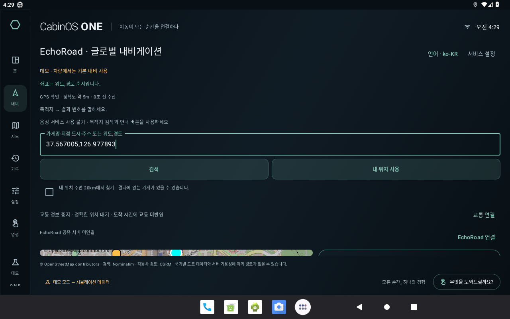

# 30분 집중 점검 — 내비·GPS·음성·조작

퓨처랩스 · 2026-10-27 · 점검 시작 13:27 한국시간

## 수정한 문제

| 항목 | 이전 동작 | 변경 |
| --- | --- | --- |
| GPS 제공자 전환 | 사용하지 않는 네트워크 위치가 꺼져도 정상 GPS를 지움 | 현재 신뢰 가능한 위치를 제공하는 서비스가 유지되면 보존. 실제 GPS 중지·위치 만료는 계속 잠금 |
| GPS 보정 응답 | 부정확한 응답과 같은 시각의 정확한 응답도 버림 | 거절했던 시각과 같은 정확한 보정만 허용. 더 오래된 응답은 계속 거절 |
| 음성 입력 | TTS를 중지해도 합성 중 상태·8초 타이머가 남음 | 마이크 시작 전에 재생 상태·합성 타이머도 정리 |
| 재탐색 버튼 | 인터넷·GPS·요청 간격 때문에 실행되지 않아도 설명 없음 | 인터넷, GPS, 진행 중 요청, 30초 간격의 남은 시간 등 사유 표시. 제한 우회 없음 |
| 불확실한 진행 방향 | 확대 지도에서는 회전 지시를 숨기지만 축소 카드에서는 표시 | 두 화면 모두 방향 확인 중으로 표시 |
| 설정 창 안전 잠금 | 숨긴 언어·서비스·교통 창이 다시 정차하면 재등장 | 창 상태 초기화, 제출하지 않은 접근키도 비움 |
| 수동 지도 조작 | GPS 복구 시 사용자가 정한 중심·확대 수준을 변경 | 수동 이동 상태를 유지. ‘내 위치로’로 추적 복귀 |
| 낮은 화면의 설정 | 큰 글씨 조건에서 마지막 입력칸 접근 실패 | 넓이·본문 높이를 제한하고 본문 스크롤 제공 |
| 검색 결과 영역 | 상단 안내가 공간을 차지해 지도·결과가 얇은 띠로 축소 | 높이가 부족하면 전체 화면을 스크롤하고, 넓은 화면은 360dp 지도·결과 가로 배치 유지. 새 첫 결과로 스크롤 |

## 실제 APK 녹화에서 확인한 이전 문제

이 이미지는 **수정 전 APK**의 Android 에뮬레이터 녹화 실패 화면입니다. GPS는 합성 입력이며 실제 주행이 아닙니다. [실행 40449690987](https://github.com/hundol047/HYUNDAI/actions/runs/40449690987)의 navigation-review가 좌표 검색 결과를 찾지 못했습니다. 화면을 확인해 검색 입력 실패로 단정했던 이전 해석을 바로잡았습니다. 경로 계산 전 화면의 결과 영역 높이가 부족했습니다.

## 검증 방식

- 수정 전 회귀 검사에서 GPS·화면·음성·지도 오류를 각각 재현했습니다.
- 낮은 화면 설정 검사는 초기 스크롤 조작에서 완료되지 않아 실행을 중단한 뒤, 실제 본문에 손가락 스와이프를 적용하는 검사로 보완했습니다. 640×360dp·글자 1.4배 조건, 마지막 입력칸 입력·닫기까지 유지했습니다. 테스트 삭제·Ignore·idle 제한 완화는 하지 않았습니다.
- GPS 변경 중 기존 ‘이전 시각 위치로 안내를 시작하면 안 됨’ 검사가 실패한 것을 발견해 수정 범위를 좁혔습니다. 기존 검사를 유지하고 재실행했습니다.
- 차량 안전 기준, 제출용 `apk/`, 서명 키, main 브랜치는 변경하지 않았습니다.

실물 S20+·Pleos 차량·실도로 주행 검증은 이번 점검 범위에 포함되지 않습니다. 공개 지도·가게 데이터의 완전성이나 실시간 교통의 정확성을 보증하지 않습니다.

## 추가한 회귀 검사

- `NavigationDetailTest.disablingUnusedNetworkProviderDoesNotInvalidateFreshGps`
- `NavigationDetailTest.disablingAnotherProviderDoesNotPreserveAnExpiredFix`
- `NavigationDetailTest.accurateCorrectionAtTheSameTimeAsARejectedFixCanRecover`
- `NavigationDetailTest.rerouteRetryExplainsOfflineAndMissingGpsInsteadOfDoingNothing`
- `SpeechRecognitionLifecycleTest.listeningCancelsPendingSynthesisAndItsFalseTimeout`
- `NavigationMapRendererTest.manualViewportSurvivesGpsLossAndRecoveryWithOrWithoutGuidance`
- `NavigationSafetyUiTest.serviceDialogAndUnsubmittedKeyAreClearedBySafetyLock`
- `NavigationSafetyUiTest.languageAndTrafficDialogsStayDismissedAfterSafetyLock`
- `NavigationSafetyUiTest.ambiguousDirectionHidesTheTurnInTheCollapsedRouteCardToo`
- `NavigationSafetyUiTest.shortVehicleWindowCanScrollToTheLastServiceSetting`
- `NavigationSafetyUiTest.shortWideNavigationDoesNotCollapseTheMapAndResultsToAStrip`

재탐색 간격은 기존 `NavigationTest`에서도 30초 → 29초 남음 및 간격 내 재요청 거절을 검사합니다. 주변 오류를 감추기 위해 기존 테스트를 완화하지 않았습니다.

## 최종 로컬 결과

`./gradlew -PpleosSdk=true :core:test :app:testDebugUnitTest :app:lintDebug :app:assemblePhonePreview` 통과(7분 7초). core 187개 + Android 293개, 총 480개 통과·실패/오류/건너뜀 0개입니다. 서버 25개·도구 60개도 통과했습니다. 새 검토용 APK는 기존 검토본과 서명 일치·정렬 검사를 통과했습니다.

[소스 CI](https://github.com/hundol047/HYUNDAI/actions/runs/40451750103)의 **current-source-debug** 실제 Android 실행 검사는 통과했습니다. 이 증거는 CI에서 빌드한 디버그 APK이며, 새로 올린 검토용 APK와 파일 해시가 같다는 뜻은 아닙니다. 나머지 CI·새 검토 APK의 기기 실행 결과는 완료 전까지 미검증으로 구분합니다. [검토본·검증 JSON](../../../preview/detail-review-verification.json)
